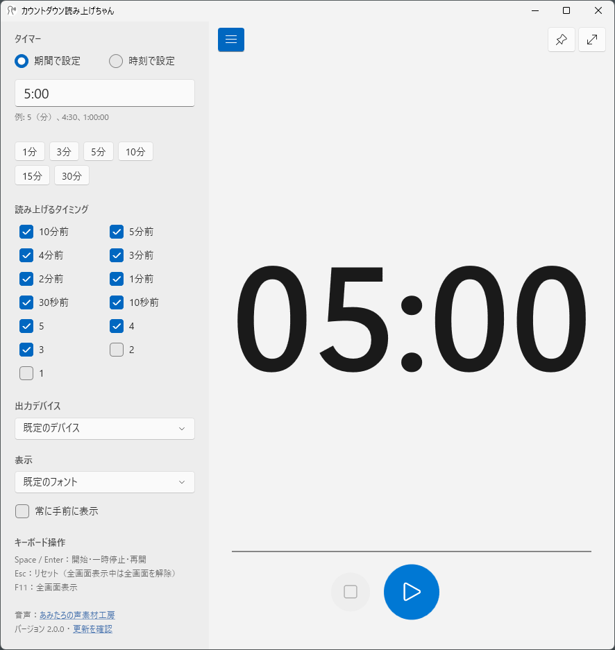

# VoiceCountdown（カウントダウン読み上げちゃん）

残り時間を大きく表示し、「10分前」「1分前」「5、4、3、2、1」のように音声で読み上げるカウントダウンタイマーです。発表・会議・試験などの時間管理に使えます。



## 動作環境

- Windows 10 / 11
- .NET 10 デスクトップランタイム

## 使い方

1. 左の設定パネルで、タイマーを「期間で設定」か「時刻で設定」から選びます。
2. 時間を入力します。
    - 期間：`5`（5分）、`4:30`（4分30秒）、`1:00:00`（1時間）。「1分」「5分」などのボタンでも入力できます。
    - 時刻：`15:00`、`9:30:15`（24時間表記）。
3. 「読み上げるタイミング」で、読み上げたい時間にチェックを入れます。
4. 必要に応じて出力デバイス（スピーカーやイヤホンなど）を選びます。
5. ▶ ボタン（または Space キー）で開始します。もう一度押すと一時停止、さらに押すと再開します。
6. ■ ボタン（または Esc キー）でリセットします。

時間になると残り時間が赤く点滅し、タスクバーのアイコンにも表示されます。

## 表示

- 残り時間はウィンドウの大きさに合わせて自動で拡大・縮小します。
- 残り1分で黄色、残り10秒で赤になります。
- 「表示」でフォントを変更できます。
- ツールバーのボタンで、設定パネルの表示・非表示、常に手前に表示、全画面表示を切り替えられます。

## キーボード操作

| キー | 操作 |
| --- | --- |
| Space / Enter | 開始・一時停止・再開 |
| Esc | リセット（全画面表示中は全画面を解除） |
| F11 | 全画面表示 |

## 設定の保存

入力した時間、読み上げるタイミング、出力デバイス、フォント、ウィンドウの大きさなどは、終了時に `%AppData%\VoiceCountdown\settings.json` へ保存され、次回起動時に復元されます。

## 開発

```
dotnet build VoiceCountdown.slnx
dotnet test VoiceCountdown.slnx
```

| プロジェクト | 内容 |
| --- | --- |
| VoiceCountdown.Desktop | WPF アプリ（画面・音声再生） |
| VoiceCountdown.Core | カウントダウンの計算、時間入力の解析、設定の保存 |
| VoiceCountdown.Core.Tests | Core の単体テスト（xUnit） |

### リリース手順

バージョン番号は [セマンティック バージョニング](https://semver.org/lang/ja/)（例: `2.1.0`）で管理します。

1. `VoiceCountdown.Desktop/VoiceCountdown.Desktop.csproj` の `<Version>` を新しい番号にする
2. `CHANGELOG.md` の「未リリース」の内容を、新しい番号と日付の見出し（例: `## [2.1.0] - 2026-11-01`）の下に移す
3. コミットして push し、同じ番号のタグを付けて push する

    ```
    git tag v2.1.0
    git push origin v2.1.0
    ```

タグを push すると GitHub Actions がテスト・発行を行い、exe を zip にまとめて [Releases](https://github.com/tam18947/VoiceCountdown/releases) に公開します。タグと `<Version>` が一致しない場合や、`CHANGELOG.md` に該当する項目がない場合は、公開せずに止まります。

## クレジット

あみたろの声素材工房 (<https://amitaro.net/>) の音声を使用しました。

## ライセンス

ソースコードは [MIT ライセンス](LICENSE) で公開しています。

ただし、`VoiceCountdown.Desktop/Sounds/` の音声ファイルは「あみたろの声素材工房」の素材で、MIT ライセンスの対象外です。利用条件は同サイトの規約に従ってください。
